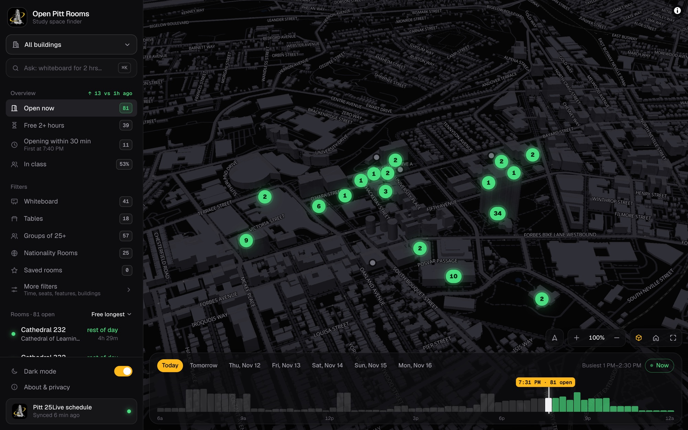
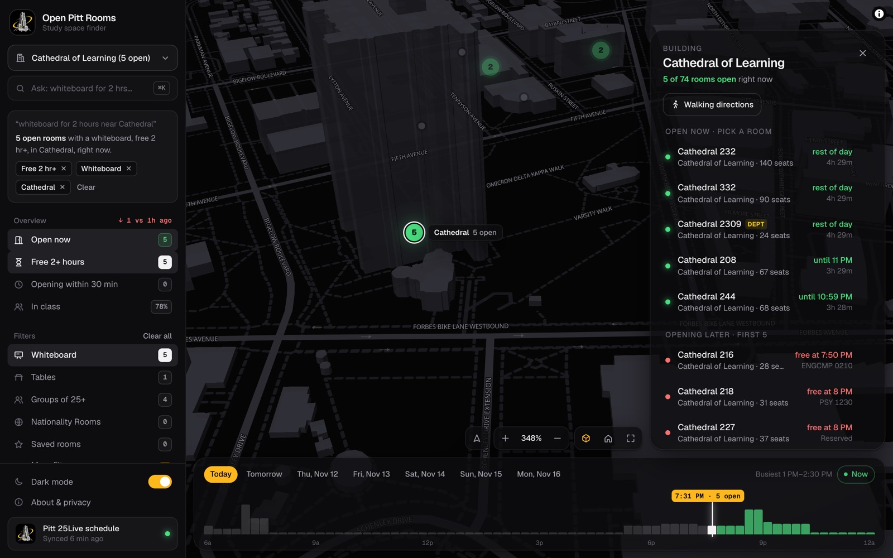
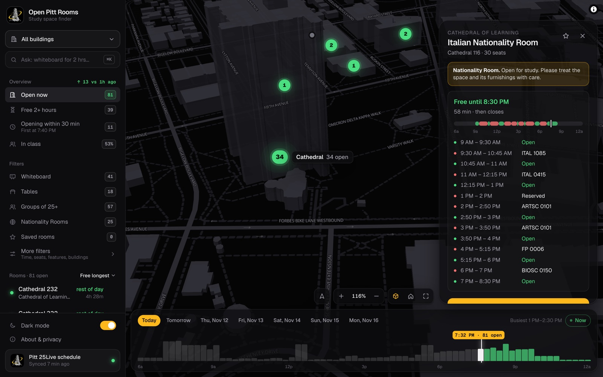
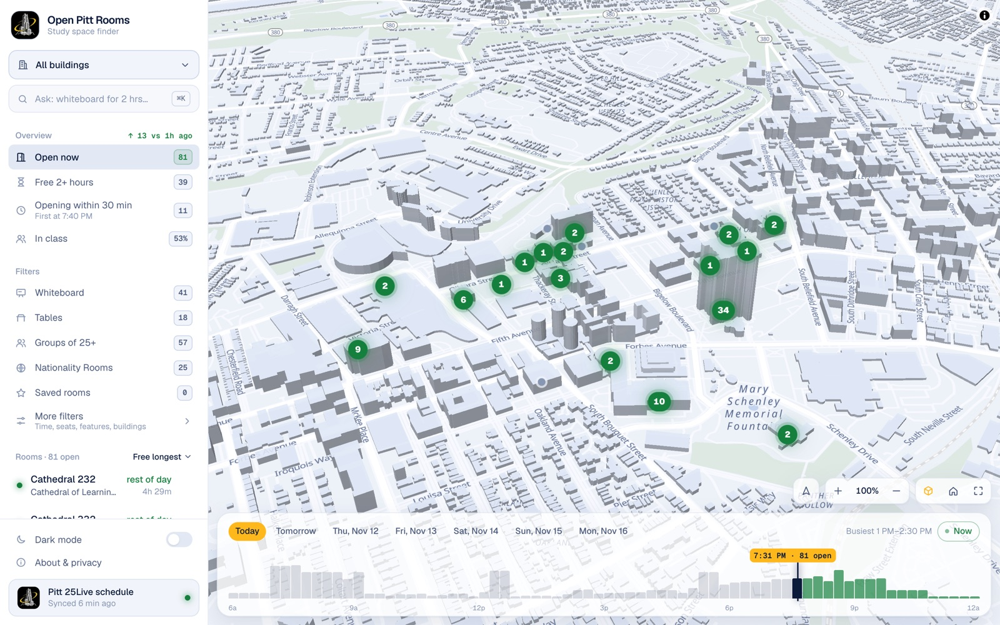
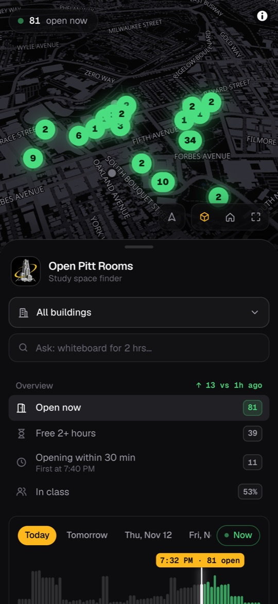
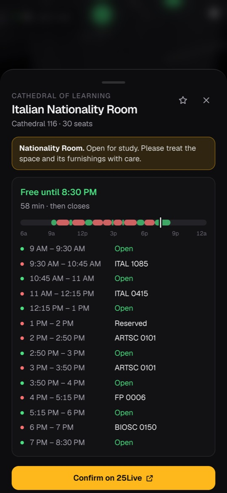

<div align="center">


# Open Pitt Rooms

**Find an open study room at Pitt, right now.**

A live 3D map of every official student study space at the University of Pittsburgh:<br />
which rooms are free, how long they stay free, and what's scheduled next.

**[Try it live at pittrooms.com](https://www.pittrooms.com)**

[](https://github.com/Shinrinyoku-Pranal/open-pitt-rooms/actions/workflows/ci.yml)
[](LICENSE)
[](tsconfig.json)

</div>

<a href="https://www.pittrooms.com"></a>

## Why it exists

Pitt's registrar keeps an official list of student study spaces, and their schedules
live in 25Live, the university's scheduling system. 25Live is built for booking
events, not for a student with forty minutes between classes.

Open Pitt Rooms turns that same public schedule into something you can read at a
glance: 170+ rooms across 21 buildings, on a map, for right now or any time in the
next week. It is free and open source, and the schedule data is cached with
permission from the Office of the University Registrar.

## What it does

<table>
<tr>
<td width="50%"></td>
<td width="50%"></td>
</tr>
<tr>
<td valign="top"><b>Ask in plain English.</b> "whiteboard for 2 hours near Cathedral" becomes filters you can see and remove.</td>
<td valign="top"><b>See a room's whole day.</b> Free until when, what's scheduled next, and when it opens up again.</td>
</tr>
</table>

- **Live 3D campus map.** Every building shows its count of open rooms, and the
  counts follow your filters. Click a building to see its rooms.
- **Ask in plain English.** "whiteboard for 2 hours near Cathedral tomorrow at 3pm"
  becomes filters. A small rule-based parser runs on your device: no AI service,
  nothing leaves the browser, and words it didn't understand are called out instead
  of silently dropped.
- **Time scrubber.** A chart of open rooms across the day. Drag it, or pick any of
  the next 7 days, and the map, the numbers and the list all follow.
- **Free until.** "Free until 3:30 PM · 2 hr 15 min · then CHEM 0110", plus each
  room's day timeline and its week at a glance.
- **Honest counts.** A room only counts as open if it stays free for at least 20
  minutes, so the 10 and 15 minute gaps between classes don't inflate the number.
- **Filters that match how students search.** Seats, whiteboard, chalkboard, tables,
  windows, accessible, A/C, lecture hall, Nationality Rooms, saved rooms, nearest
  first.
- **Made for a phone.** Installs like an app, with light and dark themes, share links
  that restore every filter, add-to-calendar, walking directions, and keyboard
  shortcuts (`/` or `⌘K`).

<p align="center">
  
  
  
</p>

## Engineering highlights

- **Any number of students for about the cost of one.** The page is static and
  re-rendered at most once a minute, the API is cached at the CDN, and room status is
  computed in the browser. Scrubbing through time or toggling a filter never touches
  the server.
- **A sync that refuses to make things worse.** [`sync.ts`](src/lib/sync.ts) parses
  25Live's responses strictly, rejects a result that lost more than half the rooms,
  writes everything in one transaction, and keeps the last good data if anything
  fails. Two independent schedulers trigger it, and the job fails loudly rather than
  report a sync that didn't happen.
- **Plain-English search without an AI service.** [`query.ts`](src/lib/query.ts) is
  a deterministic parser: each rule removes the words it understood, and whatever is
  left becomes a text search or is reported back. Same input, same answer, every
  time.
- **Availability logic as pure functions.** [`roomState.ts`](src/lib/roomState.ts)
  works out free stretches, closing hours and back-to-back classes with no framework
  or database in sight, which makes it easy to test.
- **The URL is the state.** Every filter, the chosen time and the selected room live
  in the query string, so any view is a shareable link and the back button works.
- **Privacy by default.** No accounts and no tracking cookies. Reservation titles are
  reduced to a course code or "Reserved" on the server, so names never reach the
  browser, and your location is only ever used on your device.
- **Checked on every push.** Unit tests cover the 25Live parsing, availability,
  search and time-zone logic. CI runs lint, a strict typecheck, the tests and a
  production build.

### How it works

```
Vercel Cron hourly + GitHub backup     Vercel
        │                     ┌───────────────────────────────┐
        └─► /api/cron/sync ───┤ src/lib/sync.ts               │
                              │   1 request: study-room list   │──► 25Live public JSON
                              │   1 request per day: schedule  │    (query 1196429)
                              │   validate → one transaction  │
                              └──────────────┬────────────────┘
                                             ▼
                                        Postgres (Neon)
                                             ▲
  Browser ◄── CDN ◄── / (static, revalidated every 60s, today's data inlined)
          ◄── CDN ◄── /api/rooms?date=…  (cached 60s, other days)
```

- `src/lib/pitt25live.ts` is the 25Live client. It reads the registrar's "STUDENT
  STUDY SPACES" saved search, so Pitt controls which rooms appear.
- `src/lib/sync.ts` refreshes today and tomorrow on every run and the full week
  every 6 hours, with requests spaced out to keep the load on 25Live small.
- `src/lib/roomState.ts`, `finder.ts` and `stats.ts` turn a day of schedule blocks
  into room status, filtered lists and the numbers on the dashboard.

### Tech stack

| Layer | Choice |
| --- | --- |
| App | Next.js 16 (App Router), React 19, TypeScript |
| Styling | Tailwind CSS 4 |
| Map | MapLibre GL with OpenFreeMap vector tiles (OpenStreetMap data, no API key) |
| Data | PostgreSQL on Neon, with Prisma |
| Tests | Vitest |
| Hosting | Vercel, with Vercel Cron and GitHub Actions driving the sync |

## Run it locally

Requires Node 22+. On a Mac, keep the project outside iCloud-synced folders
(Desktop, Documents): iCloud offloads `node_modules` files and Prisma hangs on them.

```bash
npm install
npm run db:local          # starts a local Postgres (no Docker needed)
cp .env.example .env      # paste the TCP URL from `npx prisma dev ls` if the port differs
npx prisma migrate dev
npm run sync              # pulls real data from 25Live (~40s the first time)
npm run dev
```

Checks: `npm run lint`, `npm run typecheck`, `npm test`, `npm run build`.

<details>
<summary><b>Deploy your own</b> (about 20 minutes, free tiers)</summary>

<br />

Planning to sync from a university's 25Live? Ask that registrar first. This project
has permission from Pitt's.

1. **Database** — create a free Postgres at [neon.tech](https://neon.tech) (or add
   Neon from the Vercel Marketplace). Copy two connection strings:
   - `DATABASE_URL`: the **pooled** string, plus `&pgbouncer=true&connection_limit=1`
   - `DIRECT_URL`: the **direct** (non-pooled) string, used for migrations
2. **Hosting** — push this repo to GitHub and import it at
   [vercel.com/new](https://vercel.com/new). Add environment variables:
   `DATABASE_URL`, `DIRECT_URL`, `CRON_SECRET` (`openssl rand -hex 32`), and
   `NEXT_PUBLIC_SITE_URL` (your final URL). Deploy — the build runs migrations.
3. **First data load** —
   `curl -H "Authorization: Bearer $CRON_SECRET" "$SITE_URL/api/cron/sync?full=1"`
4. **Scheduled sync** — `vercel.json` runs the sync about once an hour, plus a
   full refresh each morning; Vercel sends `CRON_SECRET` for you. On the Hobby
   plan each run lands at some minute within its hour. For a second, independent
   trigger, in the GitHub repo: Settings → Secrets and variables → Actions. Add
   secret `CRON_SECRET` and variable `SITE_URL`, set to the address the site
   finally loads at (`https://www.example.com` if the bare domain redirects to
   `www`). The `Sync 25Live data` workflow is scheduled hourly, but GitHub often
   delays or skips scheduled runs; run it once by hand from the Actions tab to
   confirm.
5. **Analytics** — Vercel dashboard → your project → Analytics → Enable. It's
   cookieless and counts unique visitors, so weekly active users are there from
   day one.
6. **Monitoring** — point a free uptime monitor (e.g. UptimeRobot) at
   `/api/health`. It returns 503 if the database is unreachable or data is more
   than 3 hours old, so you'll hear about a broken sync before students do.
7. **Domain** — add a custom domain in Vercel and update `NEXT_PUBLIC_SITE_URL`.

Note: GitHub pauses scheduled workflows in repos with no activity for 60 days —
push a commit or re-enable it from the Actions tab before each semester.

</details>

<details>
<summary><b>Operations</b> (what to check when something looks off)</summary>

<br />

| Symptom | Where to look |
| --- | --- |
| Stale-data banner on the site | Vercel → Cron Jobs logs; Actions → Sync 25Live data logs; `/api/health` |
| Sync workflow fails with "SITE_URL redirects" | Set the repo's `SITE_URL` variable to the final address (with `www` if the bare domain redirects) |
| Sync warning "No building configured for room …" | Pitt added a building to the study list — add it to `src/lib/buildings.ts` (code prefix + coordinates) |
| Sync error "Unexpected … shape" or "paginated" | 25Live changed its response format; existing data is kept until fixed |
| Wrong hours for a room | Hours come from 25Live's "Closed" blocks; anything before 6 AM is treated as closed |

Every sync is recorded in the `SyncRun` table with counts, warnings, and errors.

</details>

## Roadmap

Ideas being explored. Issues and pull requests on any of them are welcome.

- **Room reports.** One tap to say a room is taken or locked, so the map reflects
  what's really happening as well as the schedule.
- **More places to study.** Library group rooms, the student unions and computer
  labs alongside classrooms.
- **Alerts.** "Tell me when a room opens near me."
- **Busy-hour predictions** from schedule history.
- **Other campuses.** The Pitt-specific parts live in a handful of files: the
  building list, the 25Live search ID and the nicknames the search box knows.

## Contributing

Contributions are welcome, from typo fixes to new features. Good places to start:

- Teach the search box a new phrase or building nickname in
  [`src/lib/query.ts`](src/lib/query.ts), with a test in `tests/query.test.ts`.
- Fix a building's map position or add a new one in
  [`src/lib/buildings.ts`](src/lib/buildings.ts).
- Improve accessibility. Keyboard and screen-reader support is there; there is
  always more to do.

Run `npm run lint && npm run typecheck && npm test` before opening a pull request.
Found a bug or a wrong room? [Open an issue](https://github.com/Shinrinyoku-Pranal/open-pitt-rooms/issues).

## Credits

Built by [Pranal Siripurapu](https://github.com/Shinrinyoku-Pranal). Maps by
[MapLibre](https://maplibre.org) and [OpenFreeMap](https://openfreemap.org), with
data from OpenStreetMap contributors. Released under the [MIT License](LICENSE).

Open Pitt Rooms is an independent student project and is not affiliated with or
endorsed by the University of Pittsburgh.
